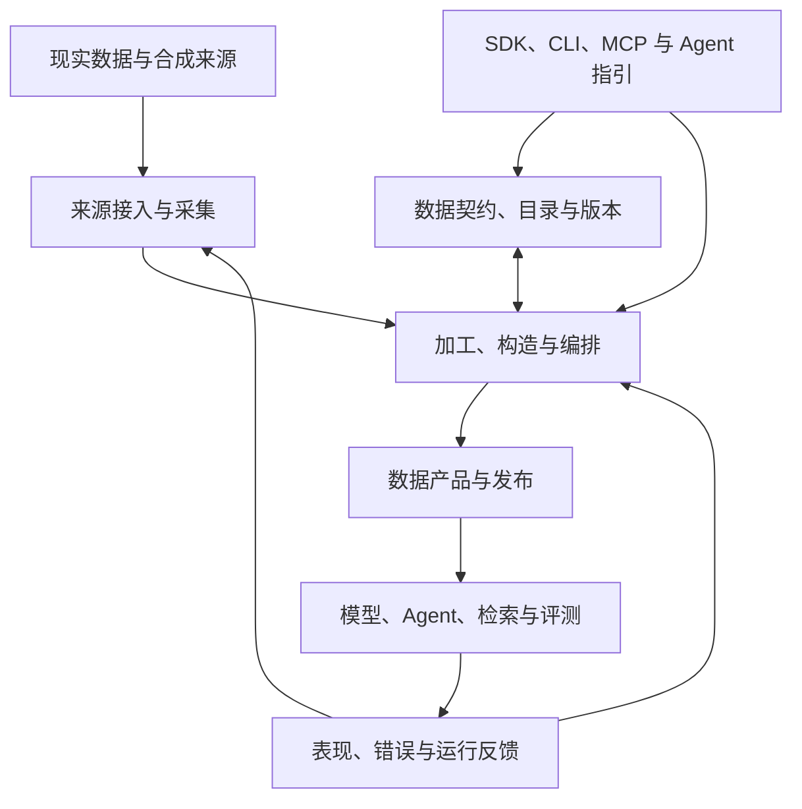

# 总体设计

Data Engineering 是独立、通用的 AI 数据研究与工程环境：将现实世界、数字系统、实验、仿真与模型产生的信息，转化为可用于学习、推理、行动和评测的数据产品，并通过使用反馈持续改进数据供给。

“覆盖所有涉及数据的地方”意味着承担完整的数据生命周期责任：数据从哪里来、代表什么、如何加工、如何交付、在哪里使用、有什么效果、怎样更新。物理存储、GPU 调度、训练优化器、仿真器和仪器驱动可以由其他系统提供，通过稳定接口接入。

目录：[基本对象](#基本对象) · [完整工作范围](#完整工作范围) · [系统结构](#系统结构) · [研究环境](#研究环境) · [关键设计决定](#关键设计决定) · [系统协作](#系统协作) · [实施次序](#实施次序)

## 基本对象

核心抽象是**带上下文的数据产品**。数据的用途与价值取决于任务、模型、使用时刻和计算预算；同一内容可以支持多个产品，但不同产品不能失去来源关系。

| 对象 | 含义 | 需要保留的信息 |
| --- | --- | --- |
| 来源 Source | 外部系统、采集过程或生成过程 | 稳定位置、版本或游标、访问方式、用途声明、事件时间与获知时间。 |
| 记录 Record / 资产 Artifact | 一项有语义的数据，以及大文件或二进制载荷 | 类型、领域结构、来源、内容标识、关联对象；大文件保留地址与摘要，按需读取。 |
| 转换 Recipe / Run | 处理规则及其一次实际执行 | 输入版本、代码/模型/提示词版本、参数、随机性、运行结果、资源成本、输出。 |
| 数据产品 Data Product / Release | 为具体消费者交付的数据与约定 | 数据结构、选择与混合规则、切分、用途、版本、刷新方式、发布清单。 |
| 使用反馈 Feedback | 消费者在具体条件下得到的结果 | 数据版本、模型/系统/环境版本、任务、表现、错误、成本与适用范围。 |

任务、演示、偏好、标签、奖励、轨迹、特征、向量、测量和记忆都属于有各自语义的记录或数据产品。避免为每个研究方向另建一套来源、版本和存储体系。领域专用结构仍由对应领域定义。

v0.3 已实现本地数据发布、按预算混合、因果序列打包、索引分片与 Python/Rust rank 读取恢复，并提供 TypeScript 与 MCP 接入。记录与发布字段见 [contracts.md](contracts.md)，消费语义见 [consumption.md](consumption.md)，公开工作负载依据见 [frontier-workloads.md](frontier-workloads.md)。

## 完整工作范围

按数据生命周期组织能力，按应用场景组合配方。场景不是彼此独立的孤岛：一段实验轨迹可以产生原始观察、动作序列、偏好样本、检索条目与后续任务。

| 生命周期 | 主要工作 | 典型输出 |
| --- | --- | --- |
| 获取与生成 | 文件/数据库/网页/知识库接入，批量与流式采集，实验和仿真，人工标注，模型合成，主动选样 | 可追溯原始数据、事件流、生成条件。 |
| 理解与整理 | 解析、OCR/ASR、结构提取、单位与坐标转换、同步对齐、实体关联、质量与分布分析 | 有领域含义的规范记录、异常与不确定性信息。 |
| 加工与构造 | 去重、标注、重标注、过滤、增强、合成、特征构造、任务与环境生成、奖励和课程构造 | 可组合的候选数据产品及其派生关系。 |
| 组织与交付 | 切分、混合、采样、分片、分词打包、索引、版本冻结、缓存与数据加载 | 训练集、评测集、特征视图、检索索引、任务包、回放数据。 |
| 运行与演进 | 使用反馈、分布变化、增量更新、重建、纠错、撤回、保留策略、数据实验 | 新版本、受影响产品列表、下一轮采集和处理策略。 |

覆盖的具体场景包括：

- **传统 ML 与预测系统**：实体粒度、标签延迟、样本选择偏差、表格与图结构、时序特征和训练/服务一致性。
- **预训练与生成模型**：文本、代码、图像、音频、视频的来源与组合；分词器/编码器版本；token、patch、帧和时长预算；稀有知识与长尾覆盖。
- **后训练**：指令与演示、工具使用、偏好与评审、奖励模型、critic/value 数据、失败纠正、多轮互动。SFT、DPO 等消费配方共享基础记录。
- **强化学习与自主 Agent**：任务生成、环境与验证器封装、轨迹和行为策略元数据、延迟奖励、回放与课程；区分离线数据与在线 rollout 所需的即时采样和时效约束。
- **检索、上下文与记忆**：文档到片段、片段到向量/索引、检索到上下文；保留来源访问约束、有效时间和更正记录，区分事实、推断和摘要。
- **多模态、机器人与世界模型**：同步的观察—动作—结果、传感器时间基准、坐标系、场景/轨迹身份与跨模态对应；不能将每一帧随机分到不同集合。
- **科学实验**：保留物理量、单位、测量误差、仪器校准、实验条件、仿真参数与干预历史；区分实际测量、数值仿真和模型预测。
- **评测与持续学习**：冻结评测、任务族与时间留出、数据污染、反馈筛选、版本比较，以及更新后的回归范围。

RLVR Data Engineering 是描述特定场景的用语，不是覆盖所有强化学习数据工程的唯一标准名称。可验证 Gym 构建同时涉及数据、任务设计、环境工程与评测工程；数据工程负责其数据生成、分布、版本和交付部分。

## 系统结构

采用一个可独立使用的核心库，把控制信息、数据处理和外部服务分开。早期通过进程内调用完成；当数据量、并发或部署边界要求独立服务时，再替换对应实现。

| 层 | 责任 | 实现路线 |
| --- | --- | --- |
| 交互与研究 | 人与 Agent 表达需求、选择配方、查看产品与结果 | Python/CLI 为基础，MCP 复用核心；Skills 和提示词提供工作方法；Web/HTTP 按实际需求加入。 |
| 契约与控制 | 来源目录、结构、版本、关系、任务与发布状态 | 当前使用文件与 manifest，混合配方固定来源版本与分区；共享部署可接入事务数据库。 |
| 数据处理 | 读取、转换、生成、分组、采样、构建与交付 | 当前提供本地构建和带预算的混合采样；更大工作负载按需接入成熟处理引擎。 |
| 存储与消费 | 保存数据字节、表、索引、缓存及消费绑定 | 当前使用 JSONL 分片、磁盘位置索引与可恢复 reader；列式交换、对象存储与表快照由后续适配器接入。 |

数据库保存产品与运行状态，大数据字节由合适的存储承担；向量索引与知识图服务提供专门查询。统一目录可以引用已有存储，无需先搬运全部数据。Redis 等缓存不承担唯一的长期状态。

连接器声明能读取什么、游标或快照如何固定、哪些字段可信、失败如何重试。操作插件声明输入输出结构、版本、确定性、资源要求和改变的语义。消费者适配器负责把通用产品转成训练器、索引器或 Gym 需要的格式。

插件与 MCP 调用实际处理核心，数据产品通过发布标识与文件位置交付。当前 MCP 同步执行本地构建、混合与检查；需要远程长任务时，再增加作业状态和结果引用接口。

## 研究环境

研究的核心问题是：**在给定任务与预算下，哪些采集、构造和组织数据的决策，能提升系统能力？**

可以写成条件性目标：

\[
\pi^* = \arg\max_\pi\; \mathbb{E}[U(\operatorname{Consumer}(D_\pi; M,H,B),T)]
\quad \text{s.t.}\quad C_{\rm collect}+C_{\rm process}+C_{\rm consume}\leq C.
\]

其中 \(\pi\) 是采集、转换与采样策略，\(M\) 为模型，\(H\) 为使用系统，\(B\) 为消费预算，\(T\) 为目标任务分布。不同数据产品的效用与成本单位由任务决定；具体方法通过固定消费者的实验或数据/消费者交叉比较来研究。

研究方向与对应实验写在 [research.md](research.md)：数据价值与覆盖、混合与课程、合成数据、可验证任务、多模态结构、持续反馈。原则是改变可解释的数据决策，观察下游能力与成本的变化。过滤分数、数据量、成功率和去重率都只是局部统计，不能替代实际消费效果。

本环境应逐步积累可复用的配方、数据实验、适配器、方法实现与失败经验。Agent 指引从问题与数据生成过程出发，调用实际工具完成工作；提示词数量不作为能力规模的衡量。

## 关键设计决定

**保留观察，显式记录解释。** 原始事件、人工标注、模型判断、验证器输出分别保留来源和版本。模型自评不能覆盖实际执行结果；重新标注产生新版本。需要纠正或删除时通过版本关系传播，不以“原始数据不可变”为理由永久保留不应保存的内容。

**先定义独立样本单位，再切分。** 文档与切块、同一用户的记录、同一实体的时间序列、同一实验样品、同一场景的帧、同一模板生成的任务常常相关。切分依据是研究问题，而不是行号。近重复、派生关系和时间泄漏需要分别处理；一种哈希规则不能替代全部分析。

**保留事件时间与获知时间。** 一个值在某日发生，并不意味着系统在当日已经知道。时序特征、检索回放与历史决策重建必须限制在当时可获得的信息范围。迟到数据、纠错与补录都要保留这两个时间维度。

**一次发布有一个明确解释。** 输入快照、代码、模型/提示词、参数、分词器、随机种子和输出构成版本记录。声明确定性的操作应可重复；远程模型生成等随机操作保存请求与原始响应，使结果可复查，但不虚称完全可重放。

**离线快照与在线更新共享身份。** 离线训练/评测固定版本，在线检索/特征可以更新。在线日志标明当时消费版本。运行记录回流形成下一版候选数据，不能悄悄改写当前实验；持续学习通过可定位的增量和检查点实现。

**生成的数据保留生成条件。** 模型、提示词、源内容、随机性与验证过程必须关联。增加近似样本不等于增加独立信息。错误、拒绝、超时、工具故障和取消都有实际含义；不能统一变成负奖励。

**用途与来源关系随产品传递。** 记录保留用途声明，构建配方据此选择数据。来源更正、版本替换与撤回通过派生关系定位受影响的分片、索引和消费记录；共享服务沿用来源系统的访问规则。

**大规模实现复用成熟基础设施。** 当前来源构建器在内存中处理记录，混合构建与读取使用磁盘索引和分片。分别测量准备、交付与消费的内存、吞吐和成本，再决定接入列式表、对象存储、流处理或专用索引。消费者通过稳定的产品与读取接口使用这些实现。

**关注数据导致的能力变化。** 比较配方时固定或明确改变的消费者、计算量、数据量与任务条件。数据和模型/harness 同时更新时，用必要的交叉组合分离来源；不把任何一个分数自动解释为普遍进步。

## 系统协作

| 系统 | 交换的内容 | 职责边界 |
| --- | --- | --- |
| 任意模型训练平台 / AI Lab | 数据版本、采样和编码配方；训练反馈与消费记录 | 数据环境组织并交付数据；训练平台执行优化与保存模型。 |
| 任意 Agent harness / Qiushi Engine | 任务需求、工具与运行轨迹、检索与记忆产品、使用反馈 | 数据环境不接管 Agent 的目标与行动控制。 |
| Verifiable Agent Gym | SQL 任务发布、任务套件、策略/尝试身份、动作轨迹与评分结果 | Gym 执行分组 rollout 和判分；数据环境构造分布、整理轨迹并交付训练分片。 |
| 知识与信息系统 / Eidolve | 来源与内容版本、文档/事实/记忆、索引及引用关系 | 可双向接入，核心不依赖某个私有知识系统。 |
| 仿真、仪器与机器人系统 | 采集计划、实验条件、观察与动作流 | 设备系统控制实际执行；数据环境负责数据语义、同步、组织与交付。 |
| 评测服务 | 冻结产品、运行配置与结果 | 独立保留评分规则；数据处理不能修改结果以迎合训练。 |

广泛覆盖通过统一责任与互操作实现，不通过把所有系统搬进一个仓库实现。

## 实施次序

从可以运行的通用核心开始，同时保留整个领域的设计视野：

1. **当前 v0.3**：记录/配方/发布契约，预算混合、保留预测目标的序列打包、索引分片与 Python/Rust 游标恢复；Python/CLI/MCP 共用实现，TypeScript 接入 Harness，任务轨迹通过可选连接器复用。
2. **实际学习与使用**：接入真实语料、任务集和训练器，把 reader 状态、模型检查点与损失构造衔接；开展混合或候选筛选实验，并交付检索产品。
3. **规模与模态**：接入成熟批处理/列式存储与多模态解码；测量数据量、吞吐、内存、I/O 和成本，再决定部署。
4. **持续数据服务**：增量、来源撤回、流数据、时间一致特征、共享目录与异步运行。
5. **数据策略研究**：依据下游结果研究混合、课程、主动采样、合成与反馈选择，逐步实现可控的自动优化。

这些步骤可以按需求交叉推进；具体完成条件和当前差距见 [roadmap.md](roadmap.md)。
