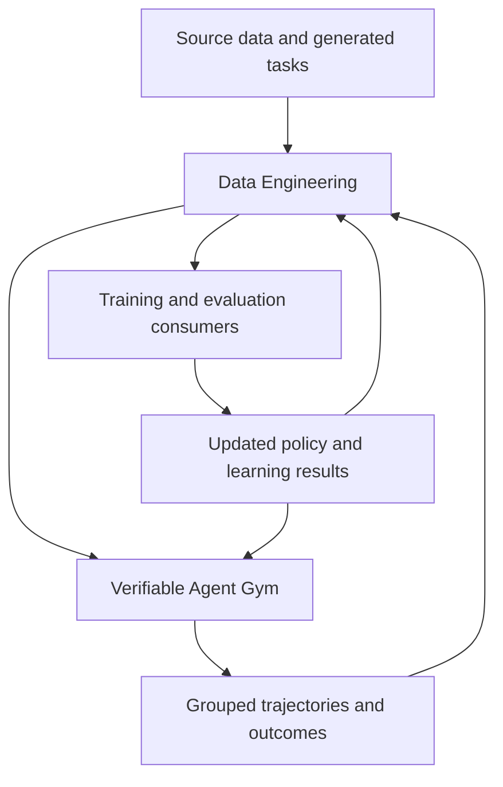

# Research workloads behind the architecture

The requirements below are derived from public technical reports and engineering articles. They guide interoperable research infrastructure; they are not descriptions of a company's private implementation.

| Public work | Concrete observation | Engineering requirement |
| --- | --- | --- |
| OpenAI, [GPT-5-Codex](https://openai.com/index/introducing-upgrades-to-codex/), September 2025 | Training covers project construction, feature work, debugging, refactoring and code review. | Tasks must represent multi-step work in executable environments, with persistent observations/actions and outcome-based feedback. |
| Google, [Gemini 2.5 report](https://arxiv.org/html/2507.06261v1), §2.1–2.4 | Data spans text, code, images, audio and video; post-training includes preferences and tool use. Sparse teacher distributions increase data volume and throughput requirements. | Preserve structured multimodal payloads and soft targets; compose, shard and deliver data efficiently to different consumers. |
| Anthropic, [agent evaluation structure](https://www.anthropic.com/research/demystifying-evals-for-ai-agents), January 2026; [infrastructure effects](https://www.anthropic.com/research/infrastructure-noise), February 2026 | Tasks, attempts, graders, traces and environment outcomes are distinct objects. Changing resource configuration produced a six-percentage-point gap in one Terminal-Bench 2.0 study. | Maintain task/attempt identity and controlled execution conditions; compare policies and data under explicit budgets and environment versions. |
| DeepSeek, [V3 report](https://arxiv.org/html/2412.19437v2), §4.1; [R1 report](https://arxiv.org/html/2501.12948v1), §2.3.3 | Corpus construction changes domain/language mixtures and document packing. R1 uses generated candidates, selection and subsequent supervised training. | Make mixture, budgets, grouping, candidate feedback and downstream consumption executable parts of the data flow. |

## Two cooperating systems

**Data Engineering** defines and constructs what a consumer learns from: source snapshots, transformations, mixtures, partitions, shards and sampling state. **Verifiable Agent Gym** supplies tasks, environments, interactions and feedback. A trainer consumes both and returns a new policy plus learning measurements.

The interfaces carry different objects. A corpus release identifies content; a mixture describes a consumption distribution; a task suite defines a distribution of opportunities to act; an episode records one attempt; a policy identifier names the behavior that produced it. A manifest alone cannot substitute for any of these operations.

## Workload dimensions

| Dimension | Questions the environment must make answerable |
| --- | --- |
| Distribution | Which sources, domains, languages, modalities, task families and difficulty ranges are represented? What is the independent sample unit? |
| Consumption | How are record/token budgets allocated? What happens when a source is exhausted? Can each worker continue the same stream after a checkpoint? |
| Interaction | Can a learner advance different episodes independently, collect several attempts per task and replace completed slots without restarting the batch? |
| Feedback | Which policy, environment and scoring rule produced the outcome? Which attempts are scored, truncated or interrupted? |
| Efficiency | How much memory, storage, I/O, environment time and model time is used? Which stage limits useful samples per second? |
| Learning | At a fixed budget, which data or task change improves downstream capability, and on what held-out distribution? |

## Current development focus

Version 0.3 connects source releases, budgeted composition, explicit causal targets and loss masks, and resumable Python/Rust consumption. TypeScript and MCP expose the same preparation operations. The authored packing example establishes target alignment and reader continuation; consumer experiments determine downstream learning value. Model-specific tokenization, large corpus curation, multimodal decoding and remote workers attach through workload-specific adapters.

Useful integrations next include an actual training framework, a larger externally sourced task set and a mature columnar/curation backend. Select them by the experiment and measured bottleneck. Their presence should change what can be trained, learned or measured.
